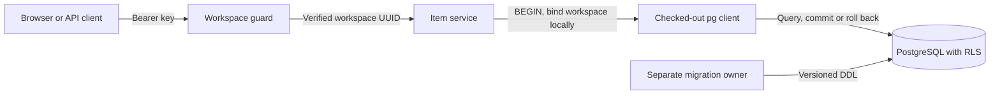

# Design and decision records

RLS Rehearsal is for SaaS engineers who want a small example of shared-table isolation and a test they can adapt. A useful first run ends with one successful workflow per team, a rejected foreign operation, and a broken fixture that proves the assertion can detect cross-tenant data.

## 1. Shared tables with row level security

Shared tables keep one schema and one migration history. An enabled and forced tenant policy protects both visibility and writes, even when a query omits the workspace predicate. The application role owns neither the schema nor the tables. Item queries also filter by workspace. The isolation suite deliberately omits that filter so it can exercise the database policy directly. Separate tenant schemas would isolate names and make per-tenant DDL possible, but would multiply migration and routing work. Revisit this if customers need separate backup, encryption, or residency boundaries.

## 2. Explicit transactions

Each operation checks out a single connection, begins a transaction, sets workspace scope with a bound parameter, and passes that client to every SQL call. Commit and rollback remove the scope. An implicit request context could reduce plumbing but would make it easier to miss a call that crosses into a different connection. Revisit only if a wider service needs composable transactions and can preserve the same guarantees under concurrency.

## 3. Provisioned bearer keys

The operator maps high-entropy key digests to workspace IDs. This keeps the example focused and supports a fully offline demo. An identity provider adds real identities, expiry, refresh, and membership lifecycle, at the cost of more setup. Revisit for any product with individual accounts, revocation audit, or organization switching.

## Add a tenant-owned table

1. Create a new migration. Keep applied SQL files immutable. Add a non-null `workspace_id`, enable and force RLS, and use both `USING` and `WITH CHECK` for the runtime role. Match existing SQL for the absent-scope expression.
2. Grant only the required verbs and columns. For a reference between tenant tables, constrain the parent key with `(workspace_id, id)` so an otherwise valid ID from another workspace cannot satisfy the reference.
3. Include the new table in the runtime checks. Add the repository query inside the existing scoped transaction.
4. Seed two tenants. Check unfiltered reads, forged inserts, foreign IDs, and access with no scope. Introduce a broken policy in a separate fixture and verify the assertion detects it.

Use [Module 1 of the learning sprint](learning-plan.md) to practice these decisions, then run the [outcome checks](outcome-verification.md) against your implementation.

## 4. Reusable isolation CLI

The demo answers the question for one schema. The `rls-rehearsal` CLI generalizes the same evidence without turning the demo into a framework. The config names actors (role, tenant, JWT claims, custom settings) and resources (table, tenant column, identifier columns). A run opens one transaction per actor, applies the session state, and reads every resource without an application filter. A row whose tenant differs from the actor's tenant is a leak.

Explicit checks cover the cases a matrix cannot: a foreign ID returning zero rows, a forged insert rejected with SQLSTATE `42501`, an update affecting zero rows, or an allowed operation. Parameter references are resolved as the other actor, so the check uses an ID that tenant can legitimately see. Every transaction is rolled back; no fixture change is committed.

Control mode is the answer to "how do you know the test can fail?". It connects with a privileged role, runs `SET LOCAL row_security = off`, and repeats the read. When foreign rows exist, the control must see them; if it does not, the assertion is filtering by tenant itself and the run fails. The control never alters a table and requires a disposable admin connection.

The CLI refuses non-loopback hosts unless `--allow-remote` is passed, refuses a tested superuser or `BYPASSRLS` role unless `--allow-privileged` is passed, and verifies that `SET LOCAL ROLE` took effect. It redacts passwords and writes only metadata, tenant values and sampled identifiers. This is a test harness, not an authorization layer: a green run is evidence for the configured roles and tables, not proof that every policy or application path is safe.

The package lives in [`cli/`](../cli/) and is versioned with the repository. The NestJS demo remains the executable reference; the CLI is the adoption path for teams with their own schema.
