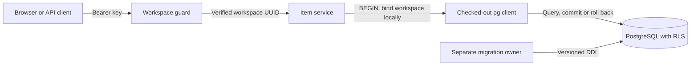

# Design and decision records

TenantProof is for SaaS engineers who want a small example of shared-table isolation and a test they can adapt. A useful first run ends with one successful workflow per team, a rejected foreign operation, and a broken fixture that proves the assertion can detect cross-tenant data.

## 1. Shared tables with row level security

Shared tables keep one schema and one migration history. An enabled and forced tenant policy protects both visibility and writes, even when a query omits the workspace predicate. The application role owns neither the schema nor the tables. Separate tenant schemas would isolate names and make per-tenant DDL possible, but would multiply migration and routing work. Revisit this if customers need separate backup, encryption, or residency boundaries.

## 2. Explicit transactions

Each operation checks out a single connection, begins a transaction, sets workspace scope with a bound parameter, and passes that client to every SQL call. Commit and rollback remove the scope. An implicit request context could reduce plumbing but would make it easier to miss a call that crosses into a different connection. Revisit only if a wider service needs composable transactions and can preserve the same guarantees under concurrency.

## 3. Provisioned bearer keys

The operator maps high-entropy key digests to workspace IDs. This keeps the example focused and supports a fully offline demo. An identity provider adds real identities, expiry, refresh, and membership lifecycle, at the cost of more setup. Revisit for any product with individual accounts, revocation audit, or organization switching.

## Add a tenant-owned table

1. Create a new migration. Keep applied SQL files immutable. Add a non-null `workspace_id`, enable and force RLS, and use both `USING` and `WITH CHECK` for the runtime role. Match existing SQL for the absent-scope expression.
2. Grant only the required verbs and columns. For a reference between tenant tables, constrain the parent key with `(workspace_id, id)` so an otherwise valid ID from another workspace cannot satisfy the reference.
3. Include the new table in the runtime checks. Add the repository query inside the existing scoped transaction.
4. Seed two tenants. Check unfiltered reads, forged inserts, foreign IDs, and access with no scope. Introduce a broken policy in a separate fixture and verify the assertion detects it.
